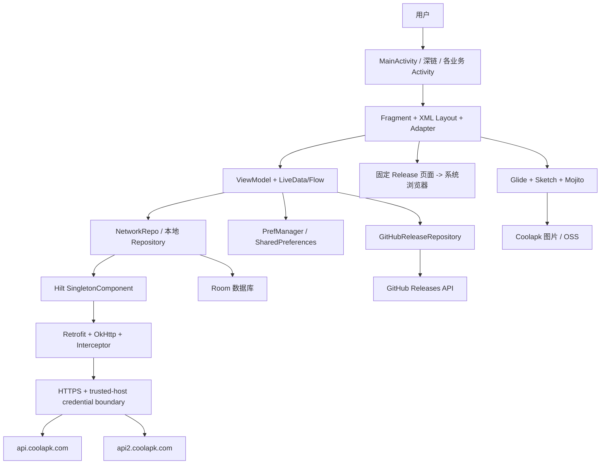

# 系统架构

## 1. 总览

`绿友` 是一个传统 Android 多模块应用，技术项目标识仍为 `c001apk`。`app` 是可运行的主应用，三个本地 library module 负责图片预览及图片加载适配。主应用没有独立 Domain 层或 Compose UI，核心调用关系是：



从源码角度，生产主链路是：

```text
Activity/Fragment
  -> ViewModel
  -> logic.repository.NetworkRepo
  -> Hilt 注入的 ApiService
  -> NetworkCallAdapter (suspendCancellableCoroutine)
  -> Retrofit Call.await()/response()
  -> Flow<Result<T>>
  -> ViewModel 更新 LiveData
  -> Fragment/Adapter 渲染
```

本地读写则是：

```text
Fragment/ViewModel
  -> HistoryFavoriteRepo / HomeMenuRepo / SearchHistoryRepo /
     BlackListRepo
  -> DAO
  -> 独立 Room 数据库
```

## 2. Gradle 模块

| 模块 | 类型 | 职责 | 主应用依赖 |
|---|---|---|---|
| `app` | Android application | 页面、网络、状态、本地数据、资源、Manifest 和 APK | 根模块 |
| `mojito` | Android library | 图片预览 Activity、Fragment、手势、转场、加载协议 | `app`、两个 loader |
| `GlideImageLoader` | Android library | 将 Glide/OkHttp 接入 Mojito 的 `ImageLoader` | `app` 间接使用 |
| `SketchImageViewLoader` | Android library | 将 Sketch/GIF/分块图片能力接入 Mojito | `app` 间接使用 |

这三个 library 的包名仍使用 `net.mikaelzero.mojito` 命名空间，属于项目内集成的图片库代码，不应误认成业务模块。

## 3. `app` 内部边界

### 3.1 启动与应用级能力

- `MyApplication` 使用 `@HiltAndroidApp` 建立依赖注入入口。
- 启动时读取 `PrefManager.darkTheme`，初始化深色模式。
- 初始化 Mojito，组合 `GlideImageLoader` 和 `SketchImageLoadFactory`。
- 注册全局未捕获异常处理器，异常时启动 `BugHandlerActivity` 并结束当前进程。
- `ActivityCollector` 用于重建或管理部分 Activity。

### 3.2 UI 层

`ui/` 以业务功能分目录，主要边界如下：

| 包 | 主要职责 |
|---|---|
| `ui/main` | 首页/关注/我的主导航、搜索动作和应用信息 |
| `ui/home`、`ui/homefeed` | 首页 Tab、关注/头条/热榜/酷图 feed |
| `ui/app` | 应用详情和单个 APK 下载 |
| `ui/feed` | 动态详情、评论分页、投票、问答、分享和只读楼中楼展示 |
| `ui/topic`、`ui/hometopic` | 话题/数码页面及其内容列表 |
| `ui/user`、`ui/follow` | 用户主页、动态、关注、粉丝和相关列表 |
| `ui/my` | 本地收藏、浏览历史和设置入口 |
| `ui/search` | 搜索入口、历史、类型/排序和结果页 |
| `ui/history`、`ui/collection`、`ui/blacklist` | 本地历史/收藏和黑名单管理 |
| `ui/settings`、`ui/settings/params` | 外观、显示、设备/请求参数和缓存设置 |
| `ui/clientupdate` | GitHub latest Release 检查和固定 Release 浏览器入口 |
| `ui/others` | WebView、外链、复制、关于和崩溃处理 |

`BaseActivity`、`BaseFragment`、`BaseViewModel`、`BaseAppViewModel` 提供通用绑定、列表状态、分页字段和只读交互。具体业务 ViewModel 仍保留较多页面级状态和请求处理，因此当前不是严格的 Clean Architecture。

### 3.3 列表和渲染

- 列表多使用 RecyclerView、ConcatAdapter、ViewBinding/Data Binding。
- `adapter/ViewBindingAdapters.kt` 负责图片、富文本、关注状态、点赞状态、关系卡片和评论行等绑定。
- `LinkTextView`、`SpannableStringBuilderUtil` 和 `MyURLSpan` 将 HTML/链接/表情转换为可点击文本。
- `NineGridImageView` 处理多图布局，并把点击交给 Mojito 全屏预览。
- 加载状态由 `LoadingState`、`FooterState` 和通用占位布局表达。

### 3.4 原生 LiquidGlass 页面 Chrome

当前 LiquidGlass 采用共享的 LiquidGlassFrameLayout，继续服务于 XML/ViewBinding/Data Binding 页面，不引入 Compose 或第二套容器。容器包含一个内部非无障碍 backdrop 层和原样保留的前景子 View；backdrop 从同一 Window 内的内容 sibling 取样，内容未布局、已 detach 或 source 不可用时使用主题色 fallback。主导航外层和搜索按钮使用 KSU/Miuix 风格的 `saturation(1.5) → blur(4dp) → rounded lens(24dp)` 效果链；选中项单独使用 56dp 玻璃胶囊，静止时仅显示低透明度明暗填色，选中移动时才把 `lens(10dp, 14dp)` 和高光进度从 0 动画到 1 并淡出。导航外沿采用单层低透明度高光，不叠加强描边；其他页面 Chrome 保持基础 RenderEffect 模糊。RuntimeShader 只作用于背景采样层，图标、文字和操作控件保持清晰。容器自身不消费系统 inset，source 的滚动、layout、attach、页面切换和配置变化只触发刷新并在销毁时清理监听。最低 API 33 对应 RuntimeShader 平台要求。

页面 slot 只覆盖稳定的操作 Chrome：

| 页面 | 玻璃 slot | source | 明确排除 |
|---|---|---|---|
| BasePager | pinned Toolbar、Tab/extraBar | pager/content sibling | pager item、特殊头部、普通列表内容 |
| User | collapsed Toolbar action | fragmentContainer 内容 sibling | 头像、统计、用户列表 |
| Feed | Toolbar；sticky sort 保持普通不透明 | Toolbar 使用 `contentLayout`；sort 不设置 backdrop source | 正文、排序栏背景采样、回复行、图片、加载/错误 |
| Search | search Toolbar | recyclerView | 输入框前景、历史和结果行 |
| Message | 已移出匿名只读范围 | none | 消息/登录 UI |

CoordinatorLayout 中的 FAB 保持直接使用 Material 控件，不包裹玻璃层，以保留 HideBottomViewOnScrollBehavior、WindowInsetsCompat margin、点击语义和 48dp 目标。Settings Preference、独立 WebView Window、BottomSheet/Dialog 也不跨 Window 借用 backdrop；它们的边界和原因记录在 Rasen change 的 window-boundary evidence 中。

## 4. 网络架构

### 4.1 当前主路径

`di/NetworkModule.kt` 注册三个 Coolapk Retrofit 服务和一个独立的 GitHub Retrofit 服务：

| Qualifier | Base URL | OkHttp 行为 | 用途 |
|---|---|---|---|
| `@Api1Service` | `https://api.coolapk.com/` | `AddCookiesInterceptor` + 最终 `NetworkCredentialBoundaryInterceptor`，跟随重定向 | 匿名只读内容、搜索、用户和应用 API |
| `@Api1ServiceNoRedirect` | `https://api.coolapk.com/` | 同上，但不跟随重定向 | 获取应用下载 `Location` |
| `@Api2Service` | `https://api2.coolapk.com/` | 复用 API1 请求头客户端和最终边界 | 动态评论、话题布局和部分用户接口 |
| `@GitHubReleaseService` | `https://api.github.com/` | 独立 HTTPS client；固定 GitHub Header 和 HTTP/1.1；不挂载 Coolapk Cookie/Token；关闭重定向 | 当前仓库 latest Release 查询 |

`NetworkRepo` 通过 `NetworkCallAdapter` 的 `suspendCancellableCoroutine` 将 Retrofit `Call<T>` 转为挂起调用，再用 `flow {}` 捕获普通异常并返回单次 `Flow<Result<T>>`。协程取消会调用底层 `Call.cancel()`；`CancellationException` 不会被转换为普通失败结果。ViewModel 通常在 `Dispatchers.IO` 启动收集，成功后更新 LiveData，失败则显示页面错误或打印堆栈。

> `NetworkEndpoints` 集中维护 API1/API2 Base URL，并由 `NetworkCredentialPolicy` 按最终 URL 判断 HTTPS 和 trusted host。构建、设备和实时 API 结果必须与源码边界分开记录；本轮已完成离线构建门禁，并在 OPPO `PGEM10` 上验证 GitHub latest API 与固定 Release 浏览器入口。

### 4.2 请求身份与状态

`AddCookiesInterceptor` 为 API1/API2 请求添加参考 `XiaoMengXinX/c001apk_next` 的 iOS 客户端身份：

- `User-Agent`、`Accept-Language`、`X-Requested-With`、`X-Sdk-Int`、`X-Sdk-Locale`。
- `X-App-Id`、`X-App-Version`、`X-App-Code`、`X-Api-Version`、`X-App-Device`、按 Unix 秒生成的 `X-App-Token`。
- `IosDeviceUtils` 生成稳定的匿名 UUID，并将 UUID 与 iPhone 档案持久化到 `credentials.xml`；Token 每秒更新。
- 匿名请求只发送 `CookieUtil.SESSID`；不读取或写入账号 UID、用户名、登录 Token 或 CDID。

`AddCookiesInterceptor` 只在 API1/API2 的 Coolapk HTTPS Host 上添加匿名请求身份；外部 `@Url`、非 HTTPS URL 和跨 Host 重定向由 `NetworkCredentialPolicy` 清理请求身份。当前不存在登录拦截器或账号请求状态机。

### 4.3 GitHub Releases 更新链路

`GitHubReleaseRepository` 使用独立的 `@GitHubReleaseService`，请求固定的 `godmiracle/Coolapk` latest Release，不携带 Cookie、Coolapk `X-App-*` Header 或账号状态。client 固定使用 HTTP/1.1，关闭重定向，并只允许 `api.github.com`，以降低部分网络环境的协商风险和 Host 漂移风险。响应由 `GitHubReleaseValidator` 做非草稿/非预发布和 semver 校验；当前版本名为 Git hash 时只显示最新稳定版，不把 hash 参与版本排序。

更新页提供固定的“浏览器下载 Release（推荐）”路径，目标为 `https://github.com/godmiracle/Coolapk/releases/latest`，在初始、检查成功或失败状态均可用。该路径只把固定网页交给系统 `ACTION_VIEW`，不传播 API 返回的任意下载 URL。应用不下载 APK、不创建更新缓存、不使用 FileProvider 传递更新包，也不启动系统 Package Installer；用户在浏览器完成下载后由 Android 系统按正常流程处理安装和覆盖安装。

### 4.4 错误和分页模型

- `NetworkCallAdapter.await/response` 将非 2xx 响应转换为 `HttpException`，需要实体的 2xx 空 body 转换为明确的 `EmptyResponseBodyException`；普通传输异常保留原始原因并由 `NetworkRepo.fire` 发出 `Result.failure`。
- 协程取消会取消底层 Retrofit `Call`，`CancellationException` 继续向上抛出，Flow 不发出普通失败结果。下载链接是例外：`Api1ServiceNoRedirect` 允许 `getAppDownloadLink` 读取 3xx `Location`，不改变其他请求的错误语义。
- feed、评论和搜索等只读接口普遍使用 `page`、`firstItem`、`lastItem` 或 `pageType/pageParam` 进行分页。
- ViewModel 自己维护 `isRefreshing`、`isLoadMore`、`isEnd`、`lastItem` 和 `FooterState`，页面之间没有统一分页组件。

### 4.5 历史网络层

`logic/network/ApiServiceCreator.kt`、`logic/network/Network.kt` 和 `logic/network/Repository.kt` 还保留一套手工创建 Retrofit、再包装成 LiveData/Flow 的实现。静态搜索显示当前 UI ViewModel 引用的是 `logic/repository/NetworkRepo.kt`，未发现业务代码调用旧 `Repository`；因此它目前是遗留/备用链路，存在接口和 Header 配置漂移风险。本次文档任务不删除它，后续应先确认没有外部使用者，再统一或移除。

## 5. 本地存储

### 5.1 SharedPreferences

`PrefManager` 将普通 UI 偏好与接口/设备状态分到两个普通 `SharedPreferences` 文件：

- 主题、主题色、纯黑模式、系统取色、字体比例、图片质量、表情显示。
- `settings.xml` 保存普通 UI 偏好以及 Coolapk/API 版本等非凭证设置。
- `credentials.xml` 保存 iOS 模拟 UUID/设备档案，以及供 WebView 使用的 `SZLMID`；旧 Android 设备参数和 `xAppToken`/`xAppDevice` 键仅作为兼容遗留数据保留，不再参与 API 请求身份生成；历史账号键启动时清理。

首次访问时 `CredentialPreferencesMigration` 清理旧 `settings.xml` 中的账号键并保留设备/API 身份；普通 UI 偏好保留。`backup_rules.xml`、`data_extraction_rules.xml` 分别排除 `credentials.xml`，但该文件仍是未加密的普通 SharedPreferences。清除应用数据会同时清除历史账号键和设备参数。

### 5.2 Room 数据库

每类数据使用独立数据库和 Qualifier，便于不同 Repository 注入：

| 数据库文件 | Entity | 用途 | 版本 |
|---|---|---|---:|
| `browse_history.db` | `FeedEntity` | 浏览历史 | 1 |
| `feed_favorite.db` | `FeedEntity` | 本地动态收藏 | 3 |
| `local_follow.db` | `LocalFollow` | 本地话题/数码关注及头像 | 2 |
| `home_menu.db` | `HomeMenu` | 首页 Tab 顺序和启用状态 | 5 |
| `search_history.db` | `StringEntity` | 搜索历史 | 2 |
| `topic_blacklist.db` | `StringEntity` | 话题黑名单 | 2 |
| `user_blacklist.db` | `StringEntity` | 用户黑名单 | 2 |

`DatabaseModule` 注册了多条迁移。当前变更对 `FeedFavorite`（历史 v1/两种 v2 到 v3）、`HomeMenu`、`LocalFollow` 和仍在使用的 `StringEntity` 数据库采用保留数据的前向迁移；编辑器专用的最近 @用户/表情数据库已移除，不再创建新实例。不得使用 destructive migration 替代仍在使用的数据迁移。

`DatabaseMigrationTest` 使用 `app/src/androidTest/assets/room-migration-fixtures/` 下的自包含旧 schema fixture，不依赖开发机残留的 `app/schemas`。当前保留的测试覆盖 FeedFavorite、HomeMenu、LocalFollow 和仍在使用的 StringEntity 数据；账号/编辑器专用迁移测试不属于当前匿名范围。

### 5.3 图片和文件

- Glide 负责常规图片加载和缓存。
- Sketch loader 支持 Mojito 所需的部分大图/GIF/分块能力。
- Mojito 负责图片全屏预览、缩放、切换、保存和分享回调。
- `FileProvider` 只暴露 `external-cache/imageShare/` 路径用于分享；客户端更新不复用该 Provider 传递 APK。
- WebView 下载使用 Android `DownloadManager`，目标目录为公共 Downloads。
- 应用缓存可由设置页清理；Room 数据库不属于该缓存清理范围。

## 6. 导航、深链和 WebView

### 6.1 主导航

`MainActivity` 使用不可左右滑动的 `ViewPager2` 承载 `HomeFragment`、嵌入式 `FollowPagerFragment` 和 `MyFragment`，底部导航的“首页 / 关注 / 我的”切换这三个页面；右侧“搜索”是动作项，启动现有 `SearchActivity`，不占用新的 ViewPager 页面。竖屏底栏以 Miuix 风格实色浮岛 overlay 在内容之上，系统导航 inset 只用于浮岛容器的 bottom margin，`ViewPager2` 不永久预留浮岛高度，避免底栏隐藏后留下内容空区；各列表继续自行处理系统底部安全区和末尾 footer。列表滚动状态统一为“拖动/惯性滚动时隐藏、进入空闲状态后展示”，基础列表和自定义列表均通过 `MainActivity` 的状态入口执行。关注页内部使用 `LocalFollowFragment` 观察 `local_follow.db`，不加载原消息聚合内容；我的页面提供本地收藏、浏览历史和 `SettingsActivity` 二级入口。首页内部再使用可配置的 Tab/ViewPager2，默认及已保存菜单不再展示“应用”Tab。

### 6.2 外链路由

`NetWorkUtil.openLink` 会先把 `coolmarket://`、`coolapk1s.com`、HTTP/HTTPS 和 `www.` 等形式规范化，再按路径映射到：

| 链接形态 | 页面 |
|---|---|
| `/feed/<id>`、`/picture/<id>` | `FeedActivity` |
| `#/feed/...`、`#/page?url=...` | `CarouselActivity` |
| `/apk/...`、`/game/...` | `AppActivity` |
| `/u/...` | `UserActivity` |
| `/t/...` | `TopicActivity` 或 `CoolPicActivity` |
| `/product/...` | `TopicActivity`（product 模式） |
| 普通 HTTP/HTTPS | `WebViewActivity` 或外部浏览器 |
| 不支持的 Scheme | Toast + 复制链接 |

`AppLinkActivity` 是 Manifest 中唯一面向外部的深链 Activity，接收自定义 `coolmarket` 和 Coolapk HTTP/HTTPS 链接后转交上述路由，再结束自身。实际深链匹配必须在设备上用 `adb shell am start` 和浏览器点击分别验证。

### 6.3 WebView

`WebViewActivity` 位于 `:webview` 独立进程，启用 JavaScript、DOM Storage、文件访问和网页下载能力，并向 `m.coolapk.com` 写入当前匿名 WebView 所需的 DID、forward 和 displayVersion Cookie，不写入账号 UID、用户名或登录 Token。它还处理 `intent://`、自定义 Scheme 和网页内下载确认。`onDestroy()` 只执行 WebView 资源释放，不调用 `exitProcess`；进程存活和 Activity 重建由 Android 生命周期管理。该页面的外链、Cookie 隔离、下载文件名和返回栈仍属于高风险验收项。

## 7. 构建与发布架构

- 根 `settings.gradle.kts` 包含四个模块，并限制仓库来源为 Google、Maven Central、JitPack、Sonatype 和 Gradle Plugin Portal。
- `gradle/libs.versions.toml` 集中维护依赖版本。
- `app` 使用 ViewBinding、Data Binding、BuildConfig、Hilt KSP、Room KSP、Glide KSP。
- Release 开启 `isMinifyEnabled` 和 `isShrinkResources`。
- GitHub Actions 使用 JDK 17，先验证 Wrapper，然后构建 Release/Debug 并上传 Actions 制品与 Release mapping。`main` Push/手动触发只保留制品流程；推送 `v*` Tag 时使用 CI Secrets 注入签名配置，并通过 `-PversionName=$GITHUB_REF_NAME` 让 APK 内部版本与 Tag 一致，再通过 `gh release create --verify-tag --generate-notes` 创建同名 GitHub Release，上传签名 APK 与 `SHA256SUMS`。当前 workflow 没有测试、lint 或设备验收步骤。

## 8. 安全、隐私和兼容性风险

1. 会话 Cookie、设备码和 User-Agent 进入请求 Header；设备/API 身份存于独立但未加密的 `credentials.xml`，该文件不参与云备份和设备迁移。
2. API1、API2 客户端只在两个 Coolapk HTTPS Host 保留设备/API Header；外部 `@Url` 和跨 Host 重定向会清理身份信息。
3. 显式开启 Debug BODY 日志时仍可能接触服务端请求或响应，当前实现会对常见 Cookie、Token、密码、验证码和 STS 字段脱敏。
4. 明文流量开关已关闭；应用控制的 HTTP 初始链接、跳转、下载和外部打开路径会先升级为 HTTPS。
5. 当前 Manifest 不声明 `QUERY_ALL_PACKAGES`；旧的第三方应用批量更新链路已移除。客户端更新不声明 `REQUEST_INSTALL_PACKAGES`，只通过系统浏览器进入 Release 页面；应用详情的单个 APK 下载仍走 Coolapk 的下载链接接口。
6. iOS 模拟设备档案可在设置中修改，改变后可能导致接口拒绝、服务端风控或数据错配；匿名 UUID 与档案保存在未加密的 `credentials.xml`。
7. API、图片地址和返回字段依赖第三方服务，必须把线上验证与编译验证分开记录。
8. 当前源码已有 Room/网络/WebView 回归测试；GitHub Actions 发布 Job 声明 `contents: write`，但只有 `v*` Tag 步骤执行 Release 写操作，签名配置来自 Secrets。`v1.1.0` 签名 Release 已验证；客户端 GitHub latest API 和浏览器跳转已在 OPPO `PGEM10` 上验证，应用不再负责流式下载或系统安装器调用，CI 仍不覆盖真实 API、分页、深链、图片保存和设备验收。

## 9. 维护规则

- 新页面优先沿用现有 XML + ViewBinding/Data Binding、ViewModel 和 `NetworkRepo` 结构，不再新增第三套网络封装。
- 修改请求 Header、登录状态、分页参数、API 路由或数据库迁移时，必须同步更新 [`docs/api.md`](api.md)、本文件和 [`docs/todo.md`](todo.md)。
- 不在源码、文档、截图或提交信息中写入真实密码、Cookie、Token、STS 凭据和签名密码。
- 任何“已实现”结论都要标注证据层级：源码存在、构建通过、模拟器验证、真实设备验证或真实接口验证。
- 对外发布前必须复核许可证、官方服务条款、权限必要性、日志等级、签名配置和隐私披露。
